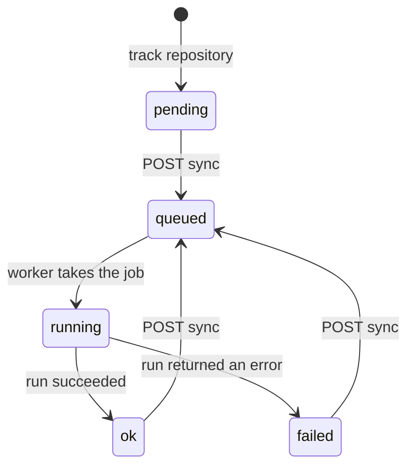
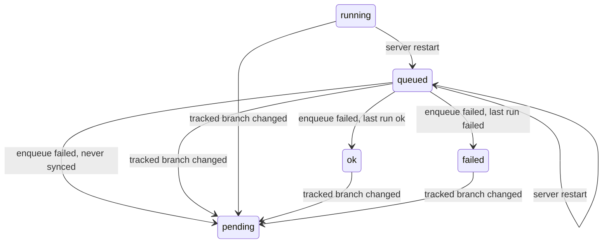

# Sync engine: repository sync states

Developer reference for `repositories.sync_status`: the states it can take, every transition, the
query that performs it, and the guard that makes it safe under concurrency. The client-facing
contract (endpoint responses, `sync_error` codes) is in [`api.md`](api.md#sync).

Code involved:

- `src/api/database/queries.sql`: every transition is one guarded `UPDATE`.
- `src/api/routers/repositories.go`: `POST /sync` (claim, enqueue, unclaim) and `PATCH` (branch change).
- `src/api/syncqueue`: the worker pool and bounded in-memory queue.
- `src/api/reposync`: the job a worker runs (running → `ok` / `failed`).
- `src/api/main.go`: startup reset of syncs left over by a previous run.

## States

| `sync_status` | Meaning                                              | `POST /sync` allowed |
| ------------- | ---------------------------------------------------- | -------------------- |
| `pending`     | Never synced, or the tracked branch changed since    | yes                  |
| `queued`      | Claimed by a request, waiting for a worker           | no (`409`)           |
| `running`     | A worker is syncing; `sync_started_at` is set        | no (`409`)           |
| `ok`          | Last finished run succeeded                          | yes                  |
| `failed`      | Last finished run failed; `sync_error` holds a code  | yes                  |

`pending`, `ok`, and `failed` are idle states; `queued` and `running` are busy states. A repository
is in at most one sync at a time because only an idle repository can be claimed.

`auto_sync` is stored and returned, but it does not drive any transition yet: syncs only start from
`POST /sync` and the startup reset.

## Main flow

The normal lifecycle of one sync request:

## Interruptions

Transitions outside the main flow: the queue rejecting a claimed job, a tracked-branch change, and
a server restart.

## Transitions

Every transition is a single `UPDATE` with a `WHERE` guard. The last column describes what happens when
the guard matches no row, which is the case concurrency makes interesting.

| #   | From → To                     | Trigger                                          | Query                                         | Guard                                                    | Guard misses                                                                                                   |
| --- | ----------------------------- | ------------------------------------------------ | --------------------------------------------- | -------------------------------------------------------- | -------------------------------------------------------------------------------------------------------------- |
| 1   | (none) → `pending`            | `POST /repositories`                             | `CreateRepository`                            | none (column default)                                    | n/a                                                                                                             |
| 2   | `pending`/`ok`/`failed` → `queued` | `POST /repositories/{id}/sync`              | `ClaimRepositorySync`                         | `sync_status NOT IN ('queued','running')`                | `409 conflict`: another sync owns the repository                                                                |
| 3   | `queued` → previous idle state | `Enqueue` fails in the same request (`503` if the queue is full, `500` otherwise) | `UnclaimRepositorySync` | `sync_status = 'queued'` | Nothing written: a branch change already moved it to `pending`                                                   |
| 4   | `queued` → `running`          | A worker takes the job                           | `MarkRepositorySyncAsRunning`                 | `sync_status = 'queued'`                                 | Stale job: `reposync.Sync` returns `nil` without doing anything                                                 |
| 5   | `running` → `ok`              | Run finished, or the branch is still at `synced_commit` | `FinalizeRepositorySync`               | `sync_status = 'running' AND sync_started_at = <this run>` | Stale run: the transaction rolls back, so its documents are discarded                                        |
| 6   | `running` → `failed`          | Run returned an error (including the 5 min job timeout) | `MarkRepositorySyncAsFailed`           | same as 5                                                | Stale run: nothing written                                                                                       |
| 7   | `queued`/`running` → `queued` | Server startup, then `EnqueueWait` for each id   | `ResetStuckRepositorySyncs`                   | `sync_status IN ('queued','running')`                    | n/a                                                                                                             |
| 8   | any → `pending`               | `PATCH` with a different `tracked_branch`        | `UpdateRepository` with `reset_sync = true`   | `id` and `user_id` only                                  | n/a                                                                                                             |
| 9   | any → (row deleted)           | `DELETE /repositories/{id}`                      | `DeleteRepository`                            | `id` and `user_id` only                                  | n/a. A run in flight finds no row, or its final write matches none.                                             |

Notes on individual transitions:

- **3 (unclaim)** rebuilds the previous state from the row, since there is no column holding it:
  `sync_error` set → `failed`, else `synced_commit` null → `pending`, else `ok`. This works only
  because claiming (2) leaves both columns untouched (see the invariants below).
- **4 (running)** clears `sync_error` and sets `sync_started_at = NOW()`, which identifies this run.
  The value is returned and passed to 5 and 6.
- **5 (ok)** writes `synced_commit` and `last_sync_at`. On the full path it runs inside the same
  transaction as the document upserts and deletes, and the transaction commits only if this
  `UPDATE` matched a row.
- **6 (failed)** runs on `context.WithoutCancel` with `markFailedTimeout` (5 s), so a job that hit
  its own deadline can still record the failure. `sync_error` gets a stable code from
  `reposync.syncErrorCode`, never an error string.
- **7 (startup reset)** cannot tell a run interrupted by a restart from one running right now, so it
  assumes a **single server** and must run before any job does.
- **8 (branch change)** also clears `synced_commit`, `sync_error`, `last_sync_at`, and
  `sync_started_at`. Clearing `sync_started_at` invalidates the in-flight run: its 5 or 6 can no
  longer match.

## Invariants

Keep these in mind when changing any of the queries above.

- **`sync_started_at` is the run token.** Only 4 sets it. 5, 6, 7, and 8 clear it. The final writes
  (5, 6) match on it, so a run that lost ownership (branch changed, possibly with a new run already
  started) writes nothing. Without it, an old-branch run could finalize a new-branch run's row.
- **While `queued`, the row still describes the last finished run.** `sync_error` and
  `synced_commit` are left alone by the claim (2) and only change at 4, 5, 6, or 8. Unclaim (3)
  depends on this. If claim ever clears `sync_error`, a failed repository whose enqueue fails comes
  back as `ok` or `pending`. It also means a client can see `queued` with a non-null `sync_error`.
- **The queue is a wake-up, not ownership.** The database row is the source of truth; an id in the
  channel only tells a worker to look. Duplicate ids are possible (a branch change followed by a new
  claim, or the startup reset) and harmless: the guard on 4 lets only one job through, and the
  others are stale.
- **Every guard is checked in the same statement as the write.** Transitions never read the status
  and then update it in a separate step, so they need no explicit locks.

## When a repository stays busy

These cases leave a repository `queued` or `running` with no worker on it. `POST /sync` returns
`409` until the next server startup, where 7 re-queues it.

| Stays     | Cause                                                                                                      |
| --------- | ---------------------------------------------------------------------------------------------------------- |
| `running` | Shutdown cancels the job context. Intentional: `reposync.Sync` skips 6 so the restart retries the sync.     |
| `running` | The write in 6 fails (logged: "state stays 'running'").                                                     |
| `running` | The job panics. `syncqueue` recovers the panic so the server survives, but nothing performs 6.              |
| `queued`  | 4 fails with a database error (logged by the worker).                                                       |
| `queued`  | The job was still in the channel at shutdown (the channel is in memory).                                    |
